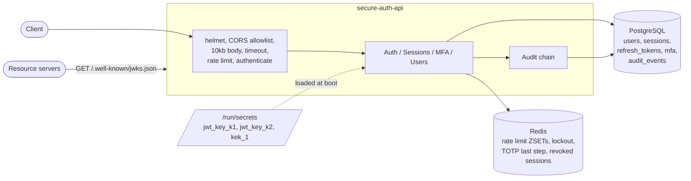
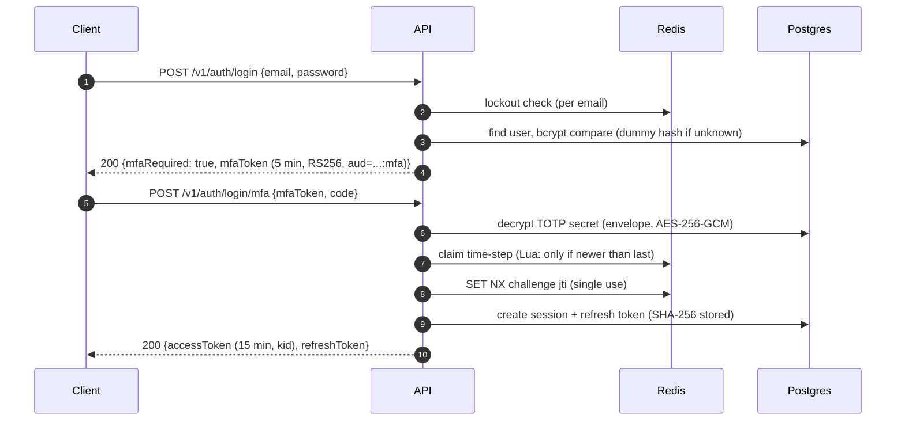
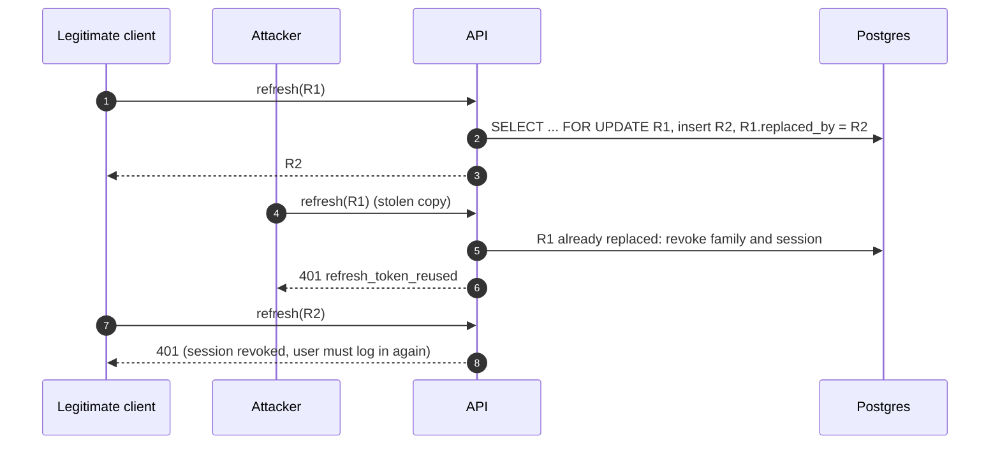

# secure-auth-api

[](https://github.com/vinihellmann/secure-auth-api/actions/workflows/ci.yml)

An authentication service built the way a security review would expect: RS256 access tokens
with a rotating JWKS, opaque refresh tokens with rotation and reuse detection, TOTP two-factor
authentication with anti-replay and single-use recovery codes, envelope encryption for stored
secrets, a hand-written sliding-window rate limiter in Lua, account lockout with exponential
backoff, and an append-only audit log chained with SHA-256.

Runs entirely with `docker compose up`; key material is generated locally on first start.

**Stack:** Node 22, TypeScript (strict), Express 5, Sequelize 6 + PostgreSQL 16, Redis 7
(ioredis), jsonwebtoken, bcryptjs, otplib + qrcode, zod, winston, helmet, umzug,
Jest + SWC + supertest, oxlint + prettier.

## Contents

- [Architecture](#architecture)
- [Flows](#flows)
- [Design decisions](#design-decisions)
- [Quick start](#quick-start)
- [API overview](#api-overview)
- [Key management and rotation](#key-management-and-rotation)
- [Running the tests](#running-the-tests)
- [Configuration](#configuration)
- [Project structure](#project-structure)
- [Trade-offs and next steps](#trade-offs-and-next-steps)

## Architecture



Resource servers validate access tokens offline with the JWKS; only this service holds private
keys.

## Flows

Login with two-factor authentication:



Refresh rotation and reuse detection:



## Design decisions

- **RS256 with `kid` and a JWKS.** Asymmetric signing lets other services verify tokens
  without sharing a secret. Every token carries the `kid` of its signing key; verification looks
  the key up by `kid` and pins `algorithms: ['RS256']`, which rules out `alg: none` and the
  HS256-with-public-key confusion attack. Two keys are generated so the next key is already
  published before it becomes active.
- **Short access tokens, opaque refresh tokens.** Access tokens live 15 minutes and are not
  stored. Refresh tokens are 256-bit random strings; only their SHA-256 is stored (a fast hash
  is fine for high-entropy secrets, unlike passwords). Each session is one rotation family.
- **Reuse detection under concurrency.** Rotation runs in a transaction that locks the token
  row (`lock: true`, `SELECT ... FOR UPDATE`). Two simultaneous refreshes with the same token
  are serialized: one wins, the other is treated as reuse and the session is revoked.
- **Immediate revocation.** JWTs cannot be recalled, so revoked session ids are written to
  Redis with a TTL equal to the access token lifetime and checked on every request. Logout,
  password change, admin lock and reuse detection take effect instantly.
- **No user enumeration.** Unknown emails go through a bcrypt comparison against a dummy hash
  of the same cost, receive the same error body, and are locked out exactly like real accounts.
- **Lockout with exponential backoff.** 5 failures lock the account for 30 s, doubling per
  further failure up to 15 minutes. Separate from the per-IP rate limit: one stops credential
  stuffing across IPs, the other stops one IP spraying many accounts.
- **Sliding-window rate limiter in Lua.** A sorted set of timestamps per key, trimmed and
  counted atomically in one script (`defineCommand`), using Redis `TIME` so app server clock
  skew does not matter. No burst at window edges, unlike a fixed window. Policies per route;
  responses carry `RateLimit-*` headers and `Retry-After` on 429.
- **TOTP with anti-replay.** A code is valid for about 90 s (one step of drift each way). The
  last accepted time-step per user is stored in Redis and only strictly newer steps pass, so a
  code cannot be used twice, even within its window.
- **Recovery codes.** Ten codes, about 50 bits each, stored as SHA-256 and consumed with a
  single conditional `UPDATE ... WHERE used_at IS NULL`, so two concurrent uses cannot both
  succeed.
- **Envelope encryption for stored secrets.** Each value gets its own random data key (DEK);
  the DEK is wrapped by a versioned key-encryption key (KEK). Both layers are AES-256-GCM. The
  data layer's associated data binds the ciphertext to its owner (`mfa:<userId>`), so a value
  copied to another row does not decrypt. Rotating the KEK only re-wraps 60-byte DEKs.
- **Tamper-evident audit log.** Each event stores `prev_hash` and `hash = SHA-256(canonical
JSON of the event + prev_hash)`. Appends take `pg_advisory_xact_lock` so the chain cannot
  fork under concurrency. A trigger rejects `UPDATE`, `DELETE` and `TRUNCATE`; if someone with
  owner rights disables it, `/verify` pinpoints the first broken link.
- **Secrets behind an interface.** `SecretsProvider` has a file implementation (Docker secrets
  layout under `/run/secrets`) and an env implementation for tests. A cloud secret manager is
  one new class; key discovery by prefix (`jwt_key_*`, `kek_*`) makes rotation a data change.
- **Hardening defaults.** helmet, CORS allowlist, 10kb JSON bodies, per-request timeout,
  `Cache-Control: no-store` on token responses, `trust proxy` explicit, problem+json errors
  that never leak internals, configuration validated by zod at boot.

## Quick start

Requirements: Docker with Compose v2, `curl`, `jq`.

```bash
docker compose up -d --build     # keygen -> migrate (+ admin seed) -> api on :3001
curl -s localhost:3001/ready | jq
curl -s localhost:3001/.well-known/jwks.json | jq '.keys[].kid'
```

Register, log in, use and rotate tokens:

```bash
API=http://localhost:3001
EMAIL="dev-$(date +%s)@example.com"
PASSWORD='Correct-Horse-9-Battery'

curl -s -X POST $API/v1/auth/register -H 'Content-Type: application/json' \
  -d "{\"email\":\"$EMAIL\",\"password\":\"$PASSWORD\"}" | jq

LOGIN=$(curl -s -X POST $API/v1/auth/login -H 'Content-Type: application/json' \
  -d "{\"email\":\"$EMAIL\",\"password\":\"$PASSWORD\"}")
ACCESS=$(echo "$LOGIN" | jq -r .accessToken)
REFRESH=$(echo "$LOGIN" | jq -r .refreshToken)

curl -s $API/v1/me -H "Authorization: Bearer $ACCESS" | jq
curl -s $API/v1/sessions -H "Authorization: Bearer $ACCESS" | jq

# Rotate, then replay the old refresh token: the session is revoked.
curl -s -X POST $API/v1/auth/refresh -H 'Content-Type: application/json' \
  -d "{\"refreshToken\":\"$REFRESH\"}" | jq '{accessToken, refreshToken}'
curl -s -X POST $API/v1/auth/refresh -H 'Content-Type: application/json' \
  -d "{\"refreshToken\":\"$REFRESH\"}" | jq '{status, code}'
```

Enable 2FA (scan `qrCodeDataUrl` or type `secret` into any authenticator app):

```bash
LOGIN=$(curl -s -X POST $API/v1/auth/login -H 'Content-Type: application/json' \
  -d "{\"email\":\"$EMAIL\",\"password\":\"$PASSWORD\"}")
ACCESS=$(echo "$LOGIN" | jq -r .accessToken)

curl -s -X POST $API/v1/mfa/totp/setup -H "Authorization: Bearer $ACCESS" | jq '{otpauthUri, secret}'
curl -s -X POST $API/v1/mfa/totp/enable -H "Authorization: Bearer $ACCESS" \
  -H 'Content-Type: application/json' -d '{"code":"123456"}' | jq   # code from the app
```

Audit log (admin seeded from `ADMIN_EMAIL` / `ADMIN_PASSWORD`):

```bash
ADMIN=$(curl -s -X POST $API/v1/auth/login -H 'Content-Type: application/json' \
  -d '{"email":"admin@example.com","password":"ChangeMe-Admin-123!"}' | jq -r .accessToken)
curl -s "$API/v1/admin/audit-events?limit=5" -H "Authorization: Bearer $ADMIN" | jq
curl -s $API/v1/admin/audit-events/verify -H "Authorization: Bearer $ADMIN" | jq
```

Interactive reference: http://localhost:3001/docs (OpenAPI document at `/openapi.yaml`).

## API overview

| Method | Path                                 | Auth   | Notes                                     |
| ------ | ------------------------------------ | ------ | ----------------------------------------- |
| POST   | `/v1/auth/register`                  | -      | 5/hour per IP                             |
| POST   | `/v1/auth/login`                     | -      | 10/min per IP + per-account lockout       |
| POST   | `/v1/auth/login/mfa`                 | -      | `mfaToken` + `code` or `recoveryCode`     |
| POST   | `/v1/auth/refresh`                   | -      | rotation, reuse detection                 |
| POST   | `/v1/auth/logout`                    | Bearer | revokes the current session               |
| GET    | `/v1/me`                             | Bearer |                                           |
| POST   | `/v1/me/password`                    | Bearer | revokes all other sessions                |
| GET    | `/v1/sessions`                       | Bearer |                                           |
| DELETE | `/v1/sessions/:id`                   | Bearer |                                           |
| POST   | `/v1/mfa/totp/setup`                 | Bearer | otpauth URI + QR, secret stored encrypted |
| POST   | `/v1/mfa/totp/enable`                | Bearer | returns 10 recovery codes once            |
| POST   | `/v1/mfa/totp/disable`               | Bearer | password + second factor                  |
| GET    | `/v1/admin/audit-events`             | admin  | filters, cursor pagination                |
| GET    | `/v1/admin/audit-events/verify`      | admin  | walks the whole chain                     |
| POST   | `/v1/admin/users/:id/lock`, `unlock` | admin  | lock revokes all sessions                 |
| GET    | `/.well-known/jwks.json`             | -      | all loaded public keys                    |
| GET    | `/health`, `/ready`                  | -      |                                           |

## Key management and rotation

`keygen` (one-shot Compose service, also `npm run keygen`) writes one file per secret into
`./secrets`, which is git-ignored and mounted read-only at `/run/secrets`:

| File         | Content                                   |
| ------------ | ----------------------------------------- |
| `jwt_key_k1` | RSA-2048 private key, PKCS#8 PEM (active) |
| `jwt_key_k2` | next signing key, already in the JWKS     |
| `kek_1`      | 32 random bytes, base64 (active KEK)      |

Signing key rotation: set `JWT_ACTIVE_KID=k2` and restart. Tokens signed by `k1` stay valid
until they expire because `k1` is still loaded; remove `jwt_key_k1` after 15 minutes and add
`k3` as the next pre-published key (`npm run keygen -- --kid k3`).

KEK rotation: generate `kek_2` (`--kek 2`), set `KEK_ACTIVE_VERSION=2`, restart, then run the
re-wrap job and remove `kek_1` once it reports nothing left on the old version:

```bash
docker compose run --rm api node dist/scripts/reencrypt.js --dry-run
docker compose run --rm api node dist/scripts/reencrypt.js
```

Envelope format (one ASCII string, safe in a `text` column):

```text
v1.<kekVersion>.<wrappedDek>.<iv>.<tag>.<ciphertext>
   wrappedDek = base64url(wrapIv[12] | wrapTag[16] | encryptedDek[32])
   iv, tag, ciphertext = base64url, AES-256-GCM over the plaintext with AAD "v1|ctx|<context>"
```

## Running the tests

```bash
npm install
npm run test:unit       # no services needed

npm run test:docker     # integration suite inside the compose network
# equivalent to:
docker compose -f docker-compose.yml -f docker-compose.test.yml run --build --rm test
```

Unit tests cover envelope encryption and tampering of every segment, the hash chain (edits,
deletions, forged links), the password policy and bcrypt cost, token signing and `kid`
rotation (including alg confusion), lockout backoff, TOTP anti-replay and the RFC 6238 test
vector.

Integration tests run against real Postgres and Redis: refresh rotation and reuse detection,
concurrent refreshes, 429 with `Retry-After`, account lockout and enumeration resistance, the
full 2FA flow, single-use recovery codes, revoked sessions rejecting live access tokens,
password change revoking other sessions, RBAC, and audit chain verification catching a row
rewritten with the trigger disabled.

CI runs lint, typecheck, build, unit tests and a formatting check on Node 22, and the
integration suite through Docker Compose.

## Configuration

Validated with zod at boot; see [`.env.example`](.env.example). Highlights:

| Variable                       | Default | Purpose                                    |
| ------------------------------ | ------- | ------------------------------------------ |
| `SECRETS_PROVIDER`             | `file`  | `file` (`SECRETS_DIR`) or `env` (tests)    |
| `JWT_ACTIVE_KID`               | `k1`    | signing key                                |
| `KEK_ACTIVE_VERSION`           | `1`     | KEK for new encryptions and re-wrapping    |
| `ACCESS_TOKEN_TTL_SECONDS`     | `900`   |                                            |
| `REFRESH_TOKEN_TTL_DAYS`       | `30`    |                                            |
| `BCRYPT_COST`                  | `12`    |                                            |
| `TRUST_PROXY`                  | `false` | set correctly behind a proxy (rate limits) |
| `CORS_ORIGINS`                 | empty   | comma-separated allowlist                  |
| `ADMIN_EMAIL`/`ADMIN_PASSWORD` | unset   | idempotent admin seed by `migrate`         |

## Project structure

```text
src/
  server.ts            entrypoint, graceful shutdown
  container.ts         composition root
  config/env.ts        zod-validated configuration
  http/                app, client context, middleware (authenticate, rate-limit, errors, request)
  infra/
    crypto/            envelope encryption, JWT key store, hashing helpers
    db/                Sequelize, models, umzug migrations (incl. audit trigger)
    rate-limit/        sliding-window limiter (Lua)
    redis/             client, stores (lockout, TOTP step, revoked sessions, MFA challenges)
    secrets/           SecretsProvider + file and env implementations
  modules/
    auth/              login, MFA step, refresh, logout, tokens, lockout
    sessions/          sessions and refresh token rotation
    mfa/               TOTP, recovery codes, enrollment
    users/             registration, profile, password change, admin lock, seed
    audit/             hash chain, repository, verification
scripts/               generate-secrets (keygen), migrate (+ seed), reencrypt
test/unit, test/integration
```

## Trade-offs and next steps

- **Account lockout can be abused for denial of service** against a known email. Backoff caps
  the damage at 15 minutes; a CAPTCHA or proof-of-work after a few failures would avoid
  locking real users out.
- **Revocation depends on Redis.** If Redis loses data, revoked sessions regain access until
  their access tokens expire (at most 15 minutes). Persisting the revocation list or shortening
  token lifetime are the knobs.
- **The audit chain proves integrity, not completeness after the fact.** Someone with database
  owner rights could truncate the tail and recompute nothing; anchoring the head hash
  periodically (to object storage with object lock or a transparency log) closes that gap.
- **Strict reuse detection** revokes the session when a client legitimately retries a refresh
  after a network failure. A short grace period for the immediately previous token is a common
  relaxation.
- **Secrets in files.** Fine for Compose and Swarm; in production prefer a KMS so KEKs never
  leave the HSM (the `SecretsProvider` and envelope layers are already shaped for it).
- **Next:** WebAuthn/passkeys, email verification and password reset flows, OpenTelemetry
  traces, and per-tenant rate limit policies.

## License

[MIT](LICENSE)
